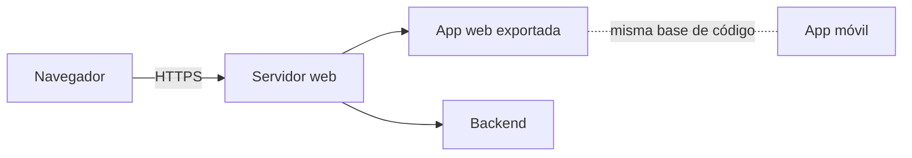

# Planner Web

Versión web de [Planner For Education](https://github.com/Jeisondls/planner-for-education). Sale de la misma base de código que la app móvil.

> Código fuente privado (producto comercial). Este documento explica el enfoque de diseño; no describe la configuración ni el despliegue del producto.

## Idea central

Una sola base de código en TypeScript para la app móvil y la web, con **React Native Web**, en lugar de mantener dos productos. En el teléfono la app se siente nativa y en el navegador se adapta a un escritorio.

## Problemas y enfoque

| Problema | Enfoque |
|---|---|
| Una pantalla pensada para el teléfono se ve pobre en un monitor grande | Componentes específicos para pantallas grandes, sin duplicar la lógica de la app |
| Algunas funciones nativas no existen en el navegador | Implementaciones específicas por plataforma que reemplazan a la versión móvil |
| El docente quiere ver el documento antes de imprimirlo | Vista previa del documento dentro del navegador |
| Publicar una versión nueva no debe requerir reiniciar nada | La web se exporta como archivos estáticos y se reemplazan al actualizar |
| El navegador puede quedarse con una versión vieja | Mecanismo para detectar y exigir una versión mínima |

## Arquitectura

## Decisiones técnicas

- **Exportación estática**, sin servidor de renderizado: menos piezas que operar y despliegue simple.
- **Extensiones por plataforma** en lugar de condicionales dispersos en el código.
- **Interfaz de escritorio** con componentes propios, sin duplicar la lógica.

## Tecnologías

React Native Web · Expo Router · TypeScript · TanStack Query

## Relacionado

[Proyecto](https://github.com/Jeisondls/planner-for-education) · [App móvil](https://github.com/Jeisondls/planner-mobile) · [Backend](https://github.com/Jeisondls/planner-odoo-backend)
