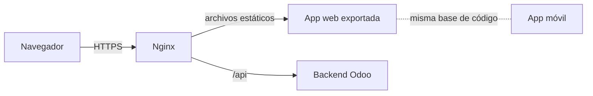

# Planner Web

Versión web de [Planner For Education](https://github.com/Jeisondls/planner-for-education), disponible en [app.plannerforeducation.com](https://app.plannerforeducation.com). Sale de la misma base de código que la app móvil.

> Código fuente privado (producto comercial). Este documento explica el diseño y las decisiones técnicas.

## Idea central

Una sola base de código en TypeScript para la app móvil y la web, con **React Native Web**, en lugar de mantener dos productos. En el teléfono la app se siente nativa y en el navegador se adapta a un escritorio.

## Problemas y soluciones

| Problema | Solución aplicada |
|---|---|
| Una pantalla pensada para el teléfono se ve pobre en un monitor grande | Componentes de escritorio específicos: barra superior, panel lateral, tablas de datos, calendario de planificaciones, matriz de asistencia mensual y vistas previas de documentos |
| Algunas funciones nativas no existen en el navegador | Archivos con sufijo `.web` que reemplazan la versión móvil: passkeys con WebAuthn, inicio de sesión con Google, selector de fecha, editor de celdas con formato y vistas previas |
| El docente quiere ver el documento antes de imprimirlo | Vista previa del informe en HTML dentro del navegador, con el tamaño y estilo de papel elegidos |
| Publicar una versión nueva no debe requerir reiniciar nada | La web se exporta como archivos estáticos y Nginx los sirve desde una carpeta. Actualizar es reemplazar los archivos |
| El navegador puede quedarse con una versión vieja en caché | Pantalla de actualización obligatoria que detecta versiones obsoletas |
| Proteger la app web de ataques comunes | Cabeceras de seguridad en Nginx: política de contenido (CSP), HSTS, protección contra incrustación y tipo de contenido |

## Arquitectura

## Decisiones técnicas

- **Exportación estática** con Expo (`build:web`), sin servidor de renderizado: menos piezas que operar y despliegue simple.
- **Extensiones por plataforma** (`.web.tsx`, `.web.ts`) en lugar de condicionales dispersos en el código.
- **Interfaz de escritorio** con componentes propios para pantallas grandes, sin duplicar la lógica de la app.
- **Transición de tema** propia para la web.

## Tecnologías

React Native Web · Expo Router · TypeScript · TanStack Query · WebAuthn · Nginx

## Relacionado

[App móvil](https://github.com/Jeisondls/planner-mobile) · [Backend Odoo](https://github.com/Jeisondls/planner-odoo-backend) · [Infraestructura](https://github.com/Jeisondls/planner-docker-infra)
